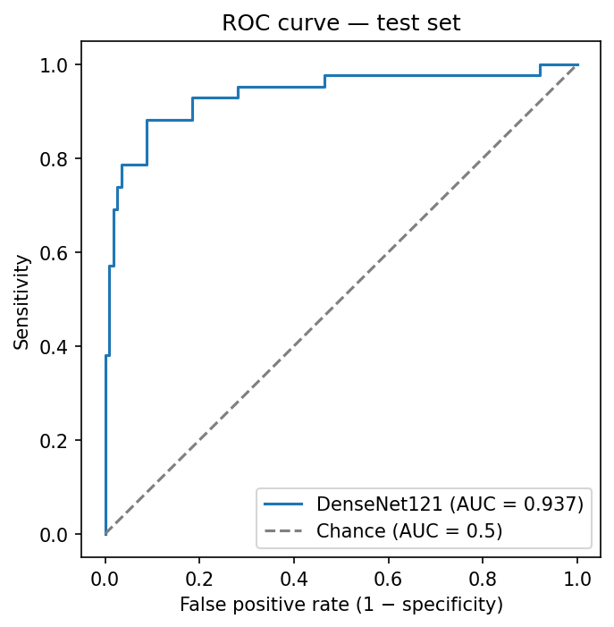
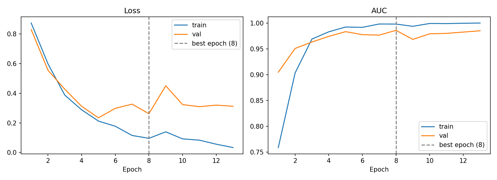
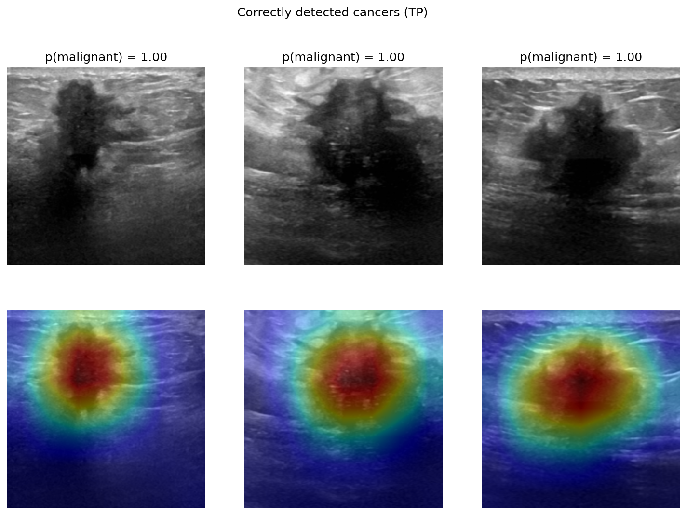
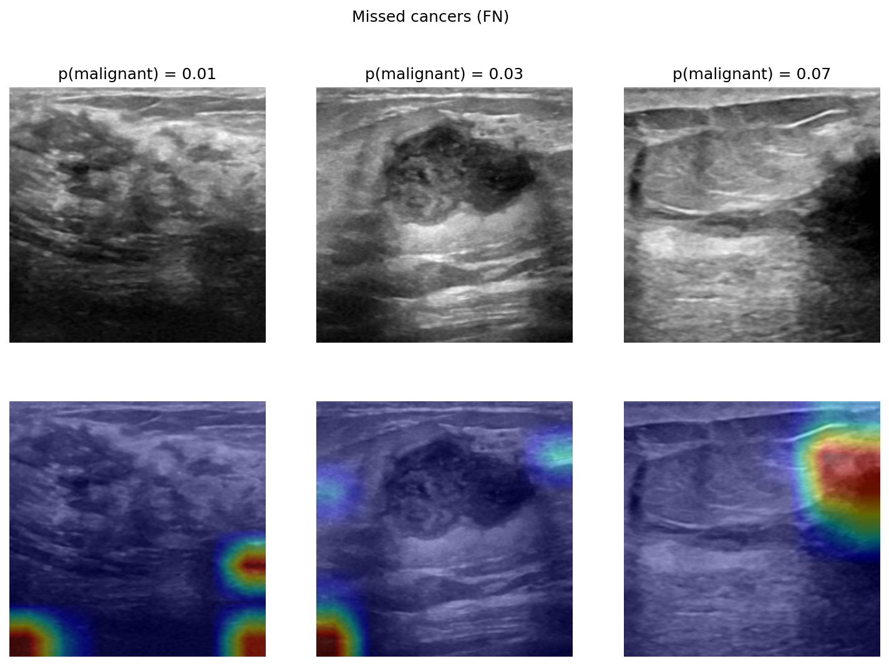

# Breast Cancer Detection in Ultrasound Images with Deep Learning

Binary classification of breast ultrasound images (**malignant vs. normal/benign**) using a **DenseNet121** pretrained on ImageNet, built with **PyTorch** and **MONAI**. The project covers the full workflow: exploratory analysis, preprocessing, transfer learning, clinical threshold selection, explainability (Grad-CAM) and error analysis.

> ⚠️ Educational project. Not intended for clinical use.

📄 [Model card](MODEL_CARD.md) · 📦 [Trained model (v1.0 release)](https://github.com/gerardagustina/breast-cancer-detection/releases/tag/v1.0)

## Key results (test set, 156 images)

| Metric | Value |
|---|---|
| **AUC** | **0.937** |
| Sensitivity @ clinical threshold | **92.9%** (39/42 cancers detected; 95% CI ≈ 81–98%) |
| Specificity @ clinical threshold | 81.6% (93/114) |

<p align="center"></p>

## Dataset

**BreastMNIST** (MedMNIST v2): 780 grayscale breast ultrasound images (224×224), derived from the BUSI dataset.

| Split | Images | Malignant |
|---|---|---|
| Train | 546 | 147 (27%) |
| Validation | 78 | 21 (27%) |
| Test | 156 | 42 (27%) |

- **Class imbalance** (27% malignant): accuracy is misleading (a model predicting "benign" for every image reaches 73%), so **AUC** and **sensitivity** are used instead.
- Splits are provided by MedMNIST and stratified by class.

## Method

| Step | Choice | Rationale |
|---|---|---|
| Preprocessing | Intensity scaling to [0, 1] | Stable training |
| Data augmentation (train only) | Horizontal flip, rotation (±15°), zoom (±10%) | Reduce overfitting. Only anatomically plausible transforms: no vertical flip (the skin is always at the top) |
| Model | DenseNet121, ImageNet weights, new 1-output head | Transfer learning with few parameters (~7M), well suited to small medical datasets |
| Loss | Binary cross-entropy with class weight (×2.7 for malignant) | Compensate class imbalance |
| Optimiser | Adam, learning rate 1e-4 | Gentle fine-tuning of pretrained weights |
| Model selection | Early stopping on validation AUC (patience 5) | Avoid overfitting |
| Reproducibility | Fixed seed (42), verified across runs | Same results on every run |

<p align="center"></p>

After epoch 8, training loss keeps decreasing while validation loss increases: a clear sign of overfitting. Early stopping kept the epoch-8 model.

## Results

The validation AUC (0.986) is higher than the test AUC (0.937). This is expected: the best epoch was selected on a small validation set, so its score is optimistically biased. **The test AUC is the unbiased estimate.**

### Clinical threshold

For screening, missing a cancer is the costliest error. Instead of the default 0.5, the threshold was chosen **on the validation set** to detect all validation cancers (threshold = 0.12), and then applied once to the test set.

| Metric (test) | Threshold 0.5 | Clinical threshold 0.12 |
|---|---|---|
| Sensitivity | 78.6% (33/42) | **92.9% (39/42)** |
| Specificity | 92.1% (105/114) | 81.6% (93/114) |
| PPV | 78.6% (33/42) | 65.0% (39/60) |
| NPV | 92.1% (105/114) | 96.9% (93/96) |

Lowering the threshold detects **6 more cancers at the cost of 12 more false alarms** (about 2 unnecessary biopsies per additional cancer detected).

## Explainability (Grad-CAM) and error analysis

**Correctly detected cancers:** Grad-CAM highlights the lesion itself, which suggests the model relies on relevant image features rather than spurious ones.

<p align="center"></p>

**Missed cancers (3/42),** all with a very low predicted probability (0.008–0.071):

<p align="center"></p>

1. **No clearly visible lesion:** the model finds no evidence anywhere in the image.
2. **Malignant lesion with benign-looking features** (posterior acoustic enhancement): a known diagnostic mimic.
3. **Lesion at the image border, partially cut off:** likely under-represented, as most training lesions are centred.

## Limitations

- **Small dataset**, especially the validation set (21 malignant cases): the clinical threshold was **unstable across random seeds** (0.12–0.40).
- **Wide confidence interval** for test sensitivity (≈ 81–98%) with only 42 malignant test cases.
- **No patient-level information**: a patient-level split could not be verified.
- **Single-centre data** and no external validation: performance on other hospitals or devices is unknown.
- **Uncalibrated probabilities:** the model's outputs should not be read as true risk estimates.

## Next steps

- **Cross-validation + ensemble** of models trained with different seeds, for a more robust threshold.
- **Probability calibration** (e.g., temperature scaling).
- **Translation augmentation** to reduce centre bias.
- **External validation** on an independent breast ultrasound dataset.

## How to run

The notebooks are designed for **Google Colab** (free GPU). Open them in order with the "Open in Colab" button at the top of each notebook:

1. `notebooks/01_EDA.ipynb`: exploratory data analysis
2. `notebooks/02_preprocessing.ipynb`: MONAI preprocessing pipeline
3. `notebooks/03_training.ipynb`: model, training, evaluation and Grad-CAM

Notebook 03 clones this repository and imports the reusable code from `src/`.

To run locally: `pip install -r requirements.txt`. To use the trained model without retraining, download `best_model.pt` from the [v1.0 release](https://github.com/gerardagustina/breast-cancer-detection/releases/tag/v1.0).

## Repository structure

```
breast-cancer-detection/
├── notebooks/          # Jupyter notebooks (EDA, preprocessing, training)
├── src/                # Reusable code: data pipeline (data.py) and model (model.py)
├── figures/            # Result figures used in this README
├── MODEL_CARD.md       # Model documentation: intended use, results, limitations
├── requirements.txt    # Pinned library versions
└── README.md
```

## Tech stack

Python · PyTorch · torchvision · MONAI · scikit-learn · NumPy · pandas · Matplotlib · Google Colab · Git

## References

- Yang, J. et al. *MedMNIST v2: A large-scale lightweight benchmark for 2D and 3D biomedical imageSS